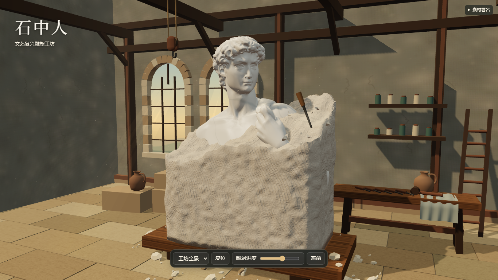

# 3D Scene Maker

把一句话、一张参考图或一组尺寸做成可以自己走近看的 3D 场景。这个 Codex skill 同时交付可双击离线打开的 HTML 和可继续修改的 Three.js 源码。

**[进入互动作品集 →](https://julyanxu.github.io/3d-scene-maker/)** · [查看 Skill](skills/3d-scene-maker/SKILL.md) · [获取项目 ZIP](https://github.com/JulyanXu/3d-scene-maker/archive/refs/heads/main.zip)

## 三个用例，三种输入

| 输入 | 打开后试一试 | 查看实现 |
| --- | --- | --- |
| **动态过程** · 让大理石中的人物逐渐显现 | [打开「石中人」](https://julyanxu.github.io/3d-scene-maker/examples/marble-workshop/scene.html)，把雕刻进度从头拖到尾，再切到特写点击「落凿」。石面留下凹痕，石屑从接触点飞出。 | [工坊源码与模型署名](examples/marble-workshop/) |
| **按图还原** · 按 4.80 × 3.60 米的原创图纸布置书房 | [打开「午后书房」](https://julyanxu.github.io/3d-scene-maker/examples/measured-study/scene.html)，固定镜头，把北窗移到西墙，观察书桌和柜子仍留在原位。 | [平面图、立面图与源码](examples/measured-study/) |
| **一句话创作** · “做一个雨后黄昏的江南渡口” | [打开「雨歇江南渡」](https://julyanxu.github.io/3d-scene-maker/examples/jiangnan-ferry/scene.html)，从河心切到石阶，轻摇船橹，看水波从桨尖散开。 | [渡口源码](examples/jiangnan-ferry/) |

下载项目 ZIP 后，用桌面 Chrome 或 Edge 打开任一示例的 `scene.html` 即可离线体验。三个用例均已在这两个浏览器中通过断网检查，验收截图和记录随源码提供。

## 用自己的需求生成场景

将 [skills/3d-scene-maker](skills/3d-scene-maker/) 整个目录复制到个人 Codex 技能目录中。Windows 默认位置为 `%USERPROFILE%\.codex\skills\3d-scene-maker`，macOS 和 Linux 默认位置为 `~/.codex/skills/3d-scene-maker`。打开新的 Codex 对话，附上手头的参考资料，试试这句话：

> 用 $3d-scene-maker 根据这张照片还原我的书房。桌面宽 1.6 米，请保留照片里的视角，再加一个能看清桌子与窗户距离的侧视角。

若要自行修改已发布的作品，在对应示例目录编辑 `src/scene.js`。用 Node.js 22 或更高版本执行 `npm ci` 和 `npm run build` 即可重新生成单文件 HTML；`npm run check` 会打开浏览器检查镜头、交互和离线加载。

## 第三方互动教学参考

- **机械拆解** · 体验 [Cessna 起落架](https://julyanxu.github.io/3d-scene-maker/examples/teardown-study/cessna-live.html)、[V8 发动机](https://julyanxu.github.io/3d-scene-maker/examples/teardown-study/v8-live.html) 和 [Strandbeest 步行机构](https://julyanxu.github.io/3d-scene-maker/examples/teardown-study/strandbeest-live.html)。三项均由 elvarofficial 和 whaleyxbt 的上游项目构建。[上游源码](https://github.com/elvarofficial/teardown/tree/a91262ac1109051e014662d42ecb0b7bc1f113b1) · [许可](examples/teardown-study/LICENSE)
- **人眼互动课** · 在原作者站点切换眼球剖面，调节物距观察焦点变化。[打开原站](https://human-eye.wasmer.app/)

场景设计方法参考了 [3D Prompt Collection](https://github.com/petergpt/3d-prompt-collection)。工坊中的《大卫》网格来自 Scan the World，衍生网格按 CC BY-SA 4.0 分发。[模型来源和改动记录](examples/marble-workshop/ASSETS.md)
